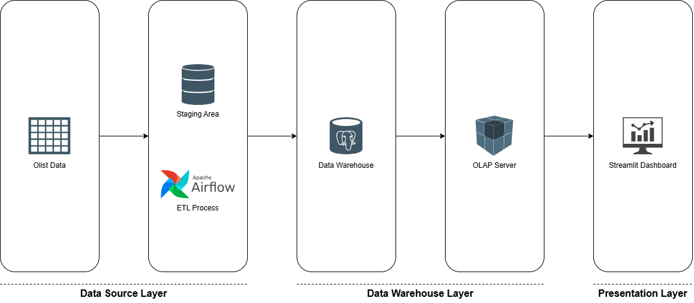

# E-commerce Data Warehouse and DSS

This project builds a small decision-support system for the Olist e-commerce dataset. It loads raw CSV files into PostgreSQL, rebuilds a dimensional warehouse, derives a late-delivery feature mart, and presents sales and delivery-risk analysis in Streamlit.

## Architecture



Airflow runs the three data pipelines on demand:

1. `olist_staging_pipeline`: profiles the source files, reloads staging, and validates it.
2. `olist_dw_pipeline`: rebuilds and validates the data warehouse.
3. `olist_ml_features_pipeline`: rebuilds and validates the ML feature mart.

Model training is a deliberate local step because the Olist data is static. It fits Logistic Regression using a chronological split and writes its output for the dashboard.

## Business questions

The system supports the following questions:

1. How do revenue and order volume change over time?
2. Which product categories and customer states contribute the most revenue?
3. How does the late-delivery rate change by month?
4. Which scored orders have the highest predicted risk of late delivery and should be prioritised for review?

## Prerequisites

- Docker Desktop with Docker Compose
- Python 3.12 or later for the notebook, model-training script, and Streamlit dashboard

Copy `.env.example` to `.env` and set the database and Airflow credentials, a valid Fernet key, and a random JWT secret before the first startup.

## Run the data platform

Start the containers from the project root:

```powershell
docker compose up --build
```

Open Airflow at `http://localhost:8080`, sign in with the admin credentials from `.env`, and unpause the DAGs if needed. Trigger each DAG manually in the order below and wait for it to succeed before starting the next one.

```text
olist_staging_pipeline
    -> olist_dw_pipeline
    -> olist_ml_features_pipeline
```

The warehouse database is exposed through the port configured by `DB_PORT` in `.env`.

## Train and score the model

After the ML feature-mart DAG finishes successfully, install the local dependencies if needed:

```powershell
pip install -r requirements-notebook.txt
```

Then train Logistic Regression and generate risk scores:

```powershell
python src\ml\train_model.py
```

The model uses six features and a chronological 70/15/15 train, validation, and test split. The validation period sets the alert threshold, and the test period evaluates the model.

The script refreshes `mart.order_late_risk` with validation and test scores, then publishes the current model and metadata under `models/`. The dashboard uses test orders only.

## Run the dashboard

In the same Python environment used for training, install the dashboard dependencies:

```powershell
pip install -r requirements-streamlit.txt
```

Start Streamlit:

```powershell
streamlit run src\app\app.py
```

Open `http://localhost:8501`. The dashboard contains:

- **Overview:** revenue, orders, average order value, and late-delivery trends.
- **Sales analysis:** revenue by product category and customer state.
- **Delivery risk simulation:** test-only order prioritisation, a 0–100% review-capacity slider, an exportable monitoring list, historical coverage, and a random-selection baseline. Technical metrics are available in an expander.

Sales revenue excludes canceled orders and freight; other statuses remain included. Sales order counts and AOV use the same non-canceled population. Category revenue per order counts only the items in that category, not the entire basket; a multi-category order can appear in multiple category groups.

The monitoring list is a historical test-cohort simulation, not a live shipment queue. Its table title is **Orders to monitor**; see [modeling notes](docs/modeling.md) for report wording and evaluation definitions. The page uses test orders only; validation still selects the model's fixed alert threshold.

Any successful staging, DW, or feature-mart rebuild invalidates saved risk scores. Run all three DAGs in the documented order, then rerun `python src/ml/train_model.py`. These are separate manual DAGs; avoid concurrent refresh/training runs. The risk page rejects missing or inconsistent scores and metadata rather than showing stale results.

## Project structure

```text
data/raw/          Source Olist CSV files
dags/              Airflow DAG definitions
src/etl/           Staging and warehouse transformations
src/ml/            Feature mart, model training, and validation
src/app/           Streamlit entry point, pages, and queries
docs/              Data, warehouse, and modeling documentation
deliverables/      Final assignment report
models/            Generated model and metadata files
```

## Submission

- [Final assignment report (PDF)](deliverables/CO4031_Assignment_L01_Group11_Report.pdf)
- [Presentation slides (PDF)](deliverables/CO4031_Assignment_L01_Group11_Slide.pdf)

## Documentation

- [Source data profile](docs/source_data_profile.md)
- [Data dictionary](docs/data_dictionary.md)
- [Modeling notes](docs/modeling.md)
- [Source entity relationships](docs/diagrams/source_entity_relationship.png)
- [Warehouse schema](docs/diagrams/dw_star_schema.png)

## Screenshots

- [Airflow DAG execution](docs/screenshots/airflow_dags_execution.png)
- [Overview](docs/screenshots/dashboard_overview_page.png)
- [Sales analysis](docs/screenshots/dashboard_sales_page.png)
- [Delivery risk simulation](docs/screenshots/dashboard_simulation_page.png)
